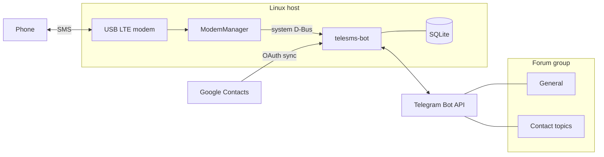
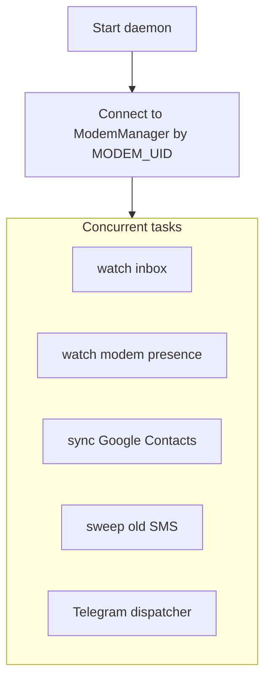
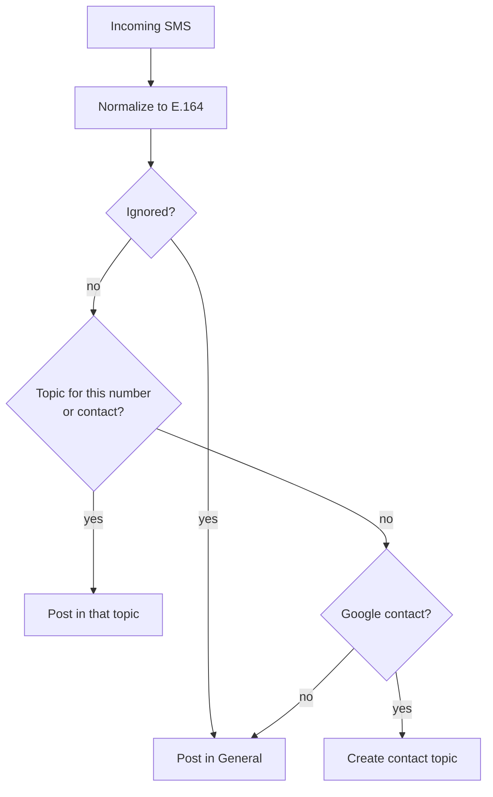
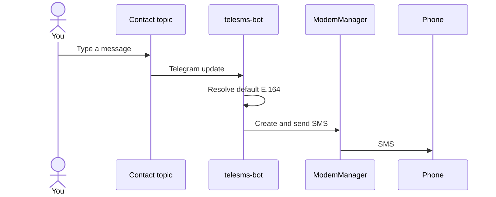
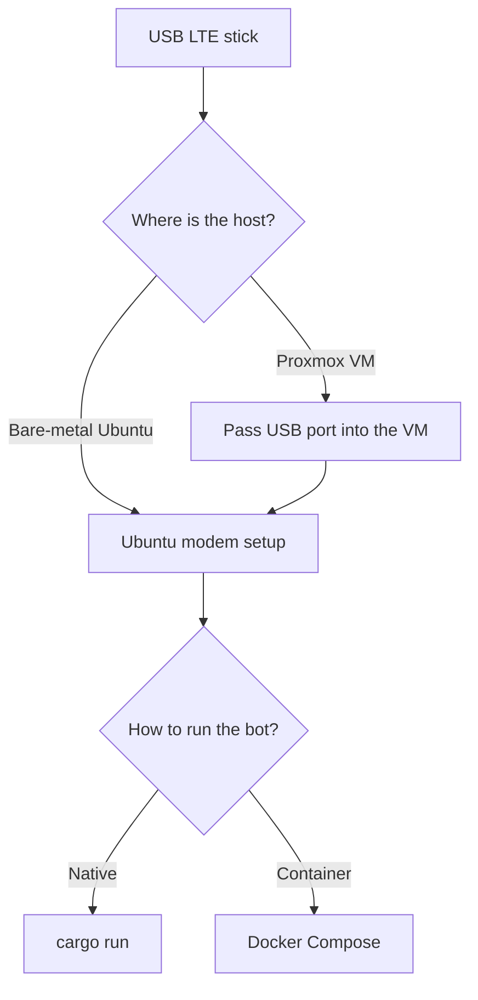

# telesms-bot

Personal two-way **SMS ↔ Telegram** gateway. A USB LTE modem on a Linux
host, owned by ModemManager, is bridged to a private Telegram **forum
group**: one General topic plus an on-demand topic per contact.

Incoming SMS land in the matching topic. Anything you type in a contact
topic is sent as SMS. Names and numbers come from Google Contacts.

| Aspect | Detail |
|---|---|
| Hardware | USB LTE stick (tested: D-Link DWM-222 / QMI) |
| Host | Ubuntu with ModemManager; optional Proxmox USB passthrough |
| Runtime | Native `cargo run`, or Docker Compose next to host ModemManager |
| Audience | A single Telegram user in a single forum group |

---

## Architecture

The bot never opens `/dev/cdc-wdm0` or `ttyUSB*`. It talks to
**host** ModemManager over the system D-Bus. Contacts sync over Google
People API. Telegram is the only user interface.



The daemon runs several loops in parallel: inbox subscribe, modem
presence, periodic contact sync, optional SMS sweep, and the Telegram
dispatcher.



---

## How messages route

**Inbound.** An SMS is normalized to E.164, then matched against Google
contacts and existing topics. Unknown or ignored numbers stay in
General.



**Outbound.** Text in a contact topic is an SMS to that topic’s default
number. Text in General is **not** sent unless you use `/sms`.



---

## Deploy

Put the stick on the machine that will run ModemManager. If that machine
is a VM, pass the USB **port** through first.



| Guide | When to use it |
|---|---|
| [Ubuntu modem setup](docs/ubuntu-modem-setup.md) | Packages, stable `MODEM_UID`, enable, register, SMS sanity check |
| [Proxmox USB passthrough](docs/proxmox-usb-passthrough.md) | Stick is on a Proxmox host; guest is Ubuntu |
| [Docker Compose](docs/deploy-docker.md) | Run the bot next to host ModemManager |

`scripts/setup-ubuntu-modem.sh` installs packages and can pin a stable
UID. Do **not** run ModemManager inside Docker. On Ubuntu, Compose sets
`apparmor:unconfined` so the mounted system D-Bus socket actually works.

---

## Quick start (native)

1. **BotFather** — create a bot, disable privacy mode, enable inline
   mode, add it to a **forum** group as admin with permission to manage
   topics.
2. Copy `.env.example` → `.env`. Fill the bot token, your Telegram user
   id, and the group id (`-100…`).
3. **Google Cloud** — OAuth desktop client with Contacts readonly. Put
   the client id and secret in `.env`. **Publish the OAuth consent
   screen** (APIs & Services → OAuth consent screen → *Publish App*):
   in Testing mode Google hard-expires refresh tokens after 7 days, in
   Production mode they last indefinitely. A personal app needs no
   verification review; re-consenting may show an "unverified app"
   warning you can accept.
4. `cargo run -- auth` writes `./secrets/google-token.json` (needs a
   browser). If an older token was minted while the app was in Testing
   mode, re-run this once after publishing so the refresh token no
   longer carries the 7-day expiry.
5. Stick **registered**: [Ubuntu modem setup](docs/ubuntu-modem-setup.md).
6. `RUST_LOG=info cargo run`
7. In General: `/sms 09… hello`. Confirm the phone and a Telegram ✓.

On the machine that owns the stick, you can skip native run and use
[Docker Compose](docs/deploy-docker.md) instead.

---

## Telegram commands

| Command | Where | What it does |
|---|---|---|
| `/help` | Any topic | Short usage |
| `/sms <number> <text>` | Any topic | Send SMS; creates or opens the contact topic |
| `/search <query>` | Any topic | Find a Google contact; tap to open or create their topic |
| `/who` | Contact topic | Name, numbers, current default |
| `/number` | Contact topic | Buttons to set the default number |
| `/ignore` | Contact / General | Stop auto-creating a topic for a number |
| `/forward` | Any forum topic | Interactive: set or disable unconditional call forwarding |
| `/status` | Any topic or a DM with the bot | Modem, SIM, call forward line, today’s counts, last in/out |

Typing in a contact topic sends SMS to that contact’s default number.

---

## HTTP API

When `API_KEY` is set in the environment, the daemon also listens for JSON
requests on `0.0.0.0:8787` (override with `API_BIND` / `API_PORT`). Send the
key in the `X-Api-Key` header.

- OpenAPI spec: [`docs/openapi.yaml`](docs/openapi.yaml)
- Design spec: [`docs/superpowers/specs/2026-08-20-http-api-design.md`](docs/superpowers/specs/2026-08-20-http-api-design.md)
- Chat history spec: [`docs/superpowers/specs/2026-08-20-chat-history-api-design.md`](docs/superpowers/specs/2026-08-20-chat-history-api-design.md)

Preview the OpenAPI spec in Swagger UI:

```bash
chmod +x scripts/openapi-preview.sh
./scripts/openapi-preview.sh
```

Then open `http://localhost:8080`.

| Route | Method | What it does |
|---|---|---|
| `/health` | GET | Liveness (no auth) |
| `/api/v1/status` | GET | Modem and today’s counts (same as `/status`) |
| `/api/v1/sms` | POST | Send SMS |
| `/api/v1/search` | POST | Search Google contacts |
| `/api/v1/open` | POST | Create or open a contact topic |
| `/api/v1/who` | POST | Contact name, numbers, default |
| `/api/v1/number` | POST | List or set the default number |
| `/api/v1/ignore` | POST | Ignore a number |
| `/api/v1/call-forward` | GET | Current unconditional forward |
| `/api/v1/call-forward` | PUT | Set `e164` or `null` to disable |
| `/api/v1/chats` | GET | Recent chats with SMS activity |
| `/api/v1/chats/{thread_id}/messages` | GET | SMS timeline for a forum thread |

---

## Realtime (WebSocket)

Opt-in second transport for clients that want messages as they arrive instead of polling. Start it
with `WS_ENABLED=true`; it listens on `127.0.0.1:8788` unless `WS_BIND` / `WS_PORT` say otherwise.
The socket authenticates with the same key as the API: send it in the `X-Api-Key` header, or as
`?api_key=` for clients that cannot set headers (browsers).

```bash
WS_ENABLED=true API_KEY=secret cargo run
websocat -H="X-Api-Key: secret" ws://127.0.0.1:8788/
```

Frames are JSON text. The server sends events for every recorded message; the client may send one
command, `send_sms`.

```jsonc
// server -> client
{"v":1,"type":"message.received","data":{"id":"in:12","direction":"in","e164":"+989121234567","body":"hello","timestamp":"2026-10-20T10:00:00.123+00:00","sms_ts":"2026-10-20T09:59:58+00:00","status":"ok","thread_id":9}}
{"v":1,"type":"message.sent","data":{…}}       // outbound, delivered
{"v":1,"type":"message.failed","data":{…}}     // outbound, failed

// client -> server
{"v":1,"type":"send_sms","id":"c1","data":{"number":"+989121234567","text":"hi"}}

// server -> client
{"v":1,"type":"ack","id":"c1","data":{"e164":"+989121234567","thread_id":9,"sent":true}}
{"v":1,"type":"error","id":"c1","error":"need_default_number","message":"need default number","numbers":["+98912…"]}
```

| Event | When |
|---|---|
| `message.received` | An inbound SMS was recorded |
| `message.sent` | An outbound SMS was delivered |
| `message.failed` | An outbound SMS failed |
| `message.updated` | A recorded message changed after it was announced (a late classification or a taught OTP code) |

Event data carries `classification` and `otp_code` (both `null` when absent), the same fields as
the HTTP API's message items.

Every client receives every event. The server pings every 30 s and closes a client that has sent
nothing within 60 s. A client that falls behind is disconnected rather than silently missing
messages: reconnect with `?after=<timestamp>` to have the gateway replay what was missed.

```bash
websocat -H="X-Api-Key: secret" "ws://127.0.0.1:8788/?after=2026-10-20T09:00:00%2B00:00"
```

Decisions behind this transport: [ADR 0001](docs/adr/0001-websocket-realtime.md). Vocabulary:
[CONTEXT.md](CONTEXT.md).

---

## SMS sorting

Messages from numbers without a contact used to all land in General with a loud notification. With
a classifier, ads, broadcasts, surveys and scams move into per-category **Sorted Threads**, and
one-time codes are pulled out of the text onto their own line. OTP extraction works with or without
a classifier. Decision record: [ADR 0002](docs/adr/0002-sms-sorting.md). Vocabulary:
[CONTEXT.md](CONTEXT.md).

### Enable the classifier

Classification is opt-in. It turns on only when `CLASSIFIER_URL` and `CLASSIFIER_MODEL` are both
set. The classifier speaks the SystemOne protocol: the gateway posts each inbound SMS with a fixed
set of questions and reads the answers. Only inbound messages are classified.

| Variable | Role |
|---|---|
| `CLASSIFIER_URL` | Classifier endpoint (SystemOne protocol) |
| `CLASSIFIER_MODEL` | Model name sent with every request |
| `SORTING_CONFIG_PATH` | Optional JSON file with the sorting config. Unset = built-in defaults |

`SORTING_CONFIG_PATH` replaces the whole config; there is no partial merge. A file that does not
parse fully stops the daemon at startup. To override, copy
[`src/sorting/default.json`](src/sorting/default.json), edit the copy, and point the variable at it.
The file holds the questions, thresholds, retry and breaker policy, sweep policy, and one entry per
Sort.

### What gets sorted

Only a message that would land in General can be sorted. Contact threads keep today's routing and
are never moved. For a General-bound message the first matching rule wins:

1. `scam` tag (`is_scam` confidence at least 0.8): the scam Sort.
2. An OTP Code was found: the `otp` Sort.
3. Classifier confidence below 0.5: stays in General.
4. Otherwise the Category's Sort.

A Sort whose thread is off stays in General. Sorted Threads are created on first use. Like General,
Sorted Threads do not send SMS: text typed there is not sent.

Default table (edit it in the override file):

| Sort | Sorted Thread | Notifications |
|---|---|---|
| `scam` | کلاهبرداری/فیشینگ | muted |
| `otp` | کد یکبارمصرف | loud |
| `promotional` | تبلیغاتی | muted |
| `broadcast` | اطلاع‌رسانی عمومی | muted |
| `feedback` | نظرسنجی | muted |
| `transactional`, `personal`, `other` | none, stays in General | loud |

A muted thread posts silently.

### Telegram post

Inbound posts use HTML, with the body escaped. When an SMS has a Classification or an OTP Code, the
post starts with a heading: the Category's emoji and bold title, plus the scam emoji and title when
tagged. An OTP Code follows on its own line as `<code>…</code>`, which Telegram shows as tap-to-copy.
Then come the number line (General and Sorted Threads) and the body. A message with neither looks as
it always did.

If no code was found but the body looks like one (a keyword `کد`, `رمز`, `code`, `otp`, `password`
or `pin`, plus a standalone 4–8 digit run after digit normalization), the post gets a **Teach code**
button.

### Teaching OTP codes

Teach the gateway a code's format from one example. Either:

- reply `/otp <code>` to any inbound SMS post, or
- press **Teach code** and reply to the bot's prompt with the code.

The gateway derives an OTP Pattern from the SMS text, validates it and stores it. That message's OTP
Code is set, its Telegram post is edited, and `message.updated` is sent over WebSocket. Only that
message is rescanned; later SMS in the same format are extracted on arrival.

A pattern must have exactly one capture group and at least one letter outside it. For example
`:\s+(\d{4,8})` is rejected.

### Background classification

When the classifier is on, a sweep runs every 300 s. It classifies inbound messages from the last
7 days that have no Classification and fewer than 5 failed attempts. After 5 failures a message is
marked `failed`. Each message gets 3 attempts of up to 10 s, with backoff of 1 s then 3 s. After 3
consecutive failed messages the breaker opens for 5 minutes, and new messages skip classification
and stay in General until the sweep reaches them. Sweep results are saved and announced as
`message.updated`. A sweep never moves a Telegram post.

Classify by hand over the whole history in `DATABASE_PATH`. This needs the classifier variables, and
announces nothing:

```bash
telesms-bot classify              # --missing (default): messages with no Classification
telesms-bot classify --failed     # messages marked failed
telesms-bot classify --force      # every message, including already classified
```

It prints `classified N, failed M`, and stops early if the classifier is unreachable.

### API and WebSocket

- Messages gain `classification` (`{category, confidence, tags}`, or `null`) and `otp_code` (string
  or `null`). WebSocket payloads carry the same two fields. See
  [Realtime (WebSocket)](#realtime-websocket) for the `message.updated` event.
- `GET /api/v1/chats/{thread_id}/messages` accepts `category=` (`transactional`, `promotional`,
  `broadcast`, `feedback`, `personal`, `other`) and `tag=scam`. Unknown values return 400.
- `GET /api/v1/chats` items gain `kind` (`general`, `contact`, `number` or `sorted`) and `sort` (the
  Sort key, or `null`).

| Route | Method | What it does |
|---|---|---|
| `/api/v1/otp-patterns` | GET | List OTP Patterns |
| `/api/v1/otp-patterns` | POST | Add a pattern: `{"pattern", "name"?}` |
| `/api/v1/otp-patterns/{id}` | DELETE | Remove one |
| `/api/v1/otp-patterns/learn` | POST | Teach from `message_id` or `body`, plus `code` and optional `name` |

---

## Configuration

Required and common variables (see `.env.example`):

| Variable | Role |
|---|---|
| `TELEGRAM_BOT_TOKEN` | BotFather token |
| `TELEGRAM_USER_ID` | Only this user may drive the bot |
| `TELEGRAM_GROUP_ID` | Forum group (`-100…`) |
| `MODEM_UID` | Must equal `mmcli` **Device** (`System.device`) |
| `GOOGLE_CLIENT_ID` / `GOOGLE_CLIENT_SECRET` | OAuth desktop client |
| `GOOGLE_TOKEN_PATH` | Default `./secrets/google-token.json` |
| `DATABASE_PATH` | Default `./data/telesms.sqlite` |
| `DEFAULT_REGION` | Phone parsing region (default `IR`) |
| `CONTACTS_SYNC_INTERVAL_SECS` | Default `21600` (6 h) |
| `SMS_DELETE_ENABLED` | Delete handled SMS from the modem (default `true`) |
| `API_KEY` | Key for the HTTP API and the WebSocket server (unset = both off) |
| `WS_ENABLED` | Start the WebSocket server (default `false`) |
| `WS_BIND` / `WS_PORT` | WebSocket listener (default `127.0.0.1:8788`) |

Any ModemManager-managed stick should work if `MODEM_UID` equals that
modem’s `System.device` field. The DWM-222 preset uses UID `dwm222`.
